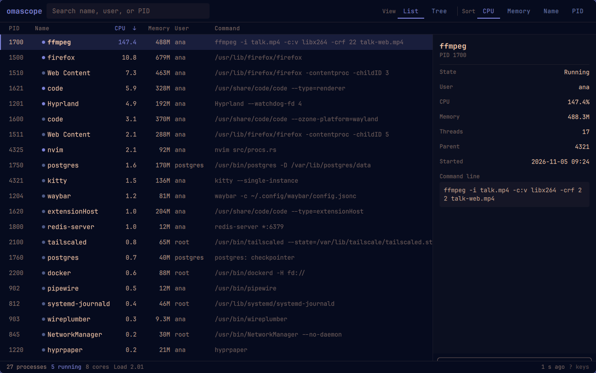

# omascope

**A keyboard-first process manager for Omarchy.**

[](docs/screenshot.png)

omascope reads `/proc`, shows what is running, and sends a signal when you ask
it to. It follows the Omarchy theme and the Omarchy language live, opens as a
normal window, and does not need a terminal.

- **One table, sorted by what is busy.** CPU, memory, name, or PID, in either
  direction. The header and the keys sort the same list.
- **A real process tree.** `Ctrl+2` indents children under their parents, with
  foldable branches; searching keeps the ancestors so a match still has its
  context.
- **Search by anything you know.** Name, command line, user, or the start of a
  PID. `Esc` puts the whole list back.
- **Ending asks first.** `Space` opens a card with the process name, its owner,
  and the difference between `SIGTERM` and `SIGKILL`. The backend reports a
  refused signal in the window instead of failing silently.
- **The theme is the theme.** Colours and corner rounding come from Omarchy's
  own `qs.Commons` shell library, so a theme switch repaints the window without
  a restart.
- **Danish, German, and Arabic ship with it.** Strings follow Setup > Language
  live, including plural forms, decimal separators, and right-to-left layout.

## Install

From this checkout, with Omarchy's Rust and Quickshell packages present:

```
bin/install
```

That builds the binary, makes the package with `makepkg`, and installs it, so
omascope appears in the launcher (`Super + Space`). Run it again after a change
you want to see there. If `cargo` comes from rustup rather than pacman, the
script skips makepkg's makedepends check and says so.

To try it without installing a package:

```
bin/run
```

The interface is QML served by Quickshell; the binary launches it with
`qs -p ui` and feeds it one process snapshot per second.

## Keyboard

Press `?` in the window for the same list.

| Action | Keys |
|---|---|
| Move the selection | `j` `k` or `↑` `↓` |
| First / last process | `g` / `G` |
| End the selected process… | `Space` (or double-click a row) |
| Fold / unfold a tree branch | `h` / `l` |
| Search | `/` |
| Clear the search or close a card | `Esc` |
| List / tree | `Ctrl+1` / `Ctrl+2` |
| Sort by CPU, memory, name, PID | `1` `2` `3` `4` |
| Reverse the current order | `s` |
| Refresh now | `r` |
| Key map | `?` |
| Quit | `q` |

## Command line

The window is one front end. These work without a display, which also makes
them usable by an agent:

```
omascope ps --json
omascope ps --sort mem --limit 10
omascope ps --filter firefox --json
omascope kill 4242 --signal TERM --json
omascope skill install
```

`ps` prints a table by default and an object with `procs` under `--json`.
`kill` takes one or more PIDs, exits 0 only when every signal was sent, and
names the reason (permission, no such process) otherwise. PID 1 and omascope
itself are always refused. `skill install` drops a short agent skill into the
first agent skill directory it finds (`~/.claude/skills`, `~/.hermes/skills`,
and so on); pass `--dir` to choose another.

## Build

Requires `cargo`, `gcc`, `make`, `quickshell`, and Omarchy's shell QML:

```
bin/build   # cargo build --release, into build/
bin/test    # cargo test
bin/run     # build, then open the window against this checkout's QML
```

The interface links Omarchy's `Commons` and `Ui` into `ui/` under the names
Quickshell imports (`qs.Commons`, `qs.Ui`), the same way Omarchy's own QML
projects do. Those two entries are symlinks, not copies.

For screenshots and interface work there is a demo stream that never reads a
real process and never sends a real signal:

```
OMASCOPE_DEMO=1 bin/run
```

## How it is put together

```
src/procs.rs     reading /proc, CPU deltas, users, memory
src/signals.rs   signal names and the one kill(2) call
src/cli.rs       serve, ps, kill, skill, opening the window
src/demo.rs      made-up processes for screenshots
ui/shell.qml     the window, keys, and the single backend pipe
ui/*.qml         chrome, table, detail rail, kill card, key map
ui/i18n/         catalogs keyed by their English text
```

The backend is a rust binary with no dependencies outside the standard
library. It streams one JSON snapshot per line on stdout and accepts `kill
<pid> <signal>` on stdin, so the window needs one pipe rather than a socket,
a database, or root.

## Licence

MIT. See [LICENSE](LICENSE).
